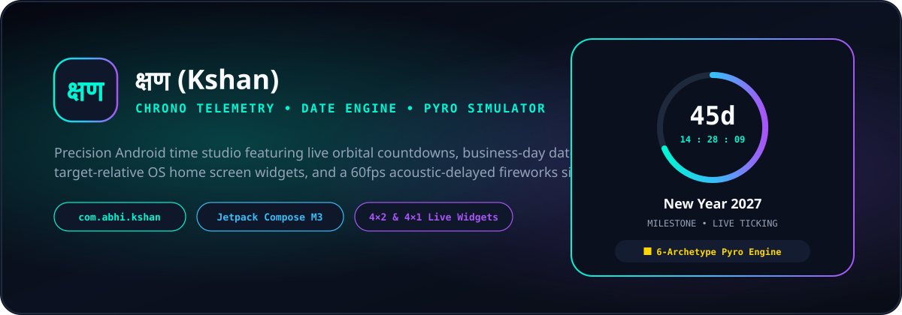

# क्षण (Kshan) — Precision Time & Countdown Studio



**क्षण (Kshan)** (`com.abhi.kshan`) is a native Android time-calculation studio, live orbital countdown tracker, customizable home-screen widget suite, and realistic ballistic fireworks simulator built with **Kotlin** and **Jetpack Compose (Material 3)**.

---

## ✨ Visual Previews & Screens

| **Span (Date Difference)** | **Shift (Date Math)** | **Countdowns & Pyro Sky** | **OS Widget Studio** |
| :--- | :--- | :--- | :--- |
| • Connected Start & End date cards<br>• Calendar vs. Business Days toggle (skips Saturdays & Sundays)<br>• Full Years / Months / Days + Total Hours / Minutes breakdown | • Add (`+`) or Subtract (`−`) up to `9,999` days<br>• Direct Typewriter number dialog + quick-jump chips<br>• Business-day aware forward/backward date projection | • Hero Orbital Timepiece with live `DD : HH : MM : SS` telemetry<br>• Category-tinted saved countdown cards with spring haptics<br>• Full-screen interactive ballistic fireworks simulator | • Live Launcher Preview (`2×2 Orbit`, `4×2 Panoramic`, `4×1 Minimal Pill`)<br>• Opacity slider, 5 neon swatches & element toggles<br>• Year, Quarter, Month & Season progress rings |

---

## 🚀 Key Features

### 1. Hard-Bundled Expressive Typography (`res/font/`)
- Zero reliance on the phone's OS system font (`FontFamily.Default` / `FontFamily.SansSerif` / `FontFamily.Monospace` are completely bypassed).
- **Comic Neue (`comic_neue.ttf`)**: Applied across all headers, titles, card labels, buttons, and descriptions.
- **Courier Prime (`courier_prime.ttf`)**: High-visibility mechanical typewriter slab-serif font applied to all numbers, dates, countdown timers (`45 : 00 : 15 : 02`), percentages (`79%`), and Unix epoch timestamps.
- **Kalam (`kalam.ttf`)**: Dedicated to the Devanagari **`क्षण`** brand glyph inside the top-left squircle and widget headers.

### 2. Multi-Format OS Home Screen Widgets & In-App Studio
- **4×2 Panoramic & 4×1 Minimal Pill**: Display remaining **Days** alongside a **live ticking `HH:MM:SS` countdown timer** powered by a native `Chronometer` configured with `base = SystemClock.elapsedRealtime() + remainderMillis` (`target − days × 24h`) so it counts down only the sub-day remainder (`23:59:59` → `00:00:00`) and swaps cleanly to `"MILESTONE REACHED"` at `0` without ever ticking negative.
- **2×2 Orbit**: Displays **Days Only** inside the orbital progress ring for compact symmetry.
- **Target-Relative Day Boundary Alarm**: Uses `updatePeriodMillis="0"` with `AlarmManager.setAndAllowWhileIdle()` scheduled at each exact 24-hour boundary relative to the target timestamp (plus `ACTION_TIME_SET`, `ACTION_TIMEZONE_CHANGED`, and `ACTION_BOOT_COMPLETED` receivers) — requiring zero special exact-alarm permissions on Android 14+.

### 3. 2-Stage Ballistic Fireworks Simulator (`PyroPhysicsEngine` + `PyroSoundEngine`)
- **6 Pyrotechnic Shell Archetypes**:
  1. `CHRYSANTHEMUM` — Dense spherical bloom with lingering spark trails.
  2. `WILLOW` — High-drag weeping gold & electric cyan tendrils.
  3. `RING_SATURN` — Outer neon ring + tilted inner golden ring.
  4. `STROBE_CRACKLE` — White-hot 22Hz strobe tips with micro-crackle pops.
  5. `PEONY_CROSSETTE` — Multi-layer shells that split mid-air into 4 perpendicular cross-jets.
  6. `HORSETAIL` — Directional heavy gold & silver waterfall cascade.
- **Atmospheric Lighting & Volumetric Smoke**: Dynamic sky-flash luminance decay + drifting post-detonation smoke clouds.
- **Speed-of-Sound Acoustic Delay**: Burst flash occurs immediately on apex while the synthesized low-end boom (`AudioTrack` 24kHz PCM) and multi-stage haptic shockwave arrive `65ms–235ms` later based on burst altitude.
- **Choreographed Auto Finale Show (`🎬 Auto Show`)**: Automated V-shape fans, rapid step-sequences, and multi-shell sky barrages.
- **Power Saver GPU Cap**: Automatically caps active sparks (`1,200` normal / `350` Power Saver) and disables volumetric smoke when Battery Saver is enabled.

### 4. Lifecycle-Aware Telemetry & Room Persistence
- The 1Hz telemetry loop runs inside `lifecycleOwner.repeatOnLifecycle(Lifecycle.State.STARTED)` so zero CPU/battery is consumed when the app is backgrounded.
- Saved countdowns and calculation history are persisted locally via **Room** (`exportSchema = true` with schemas exported to `app/schemas/`).

---

## 🏗️ Project Architecture

```text
app/src/main/java/com/abhi/kshan/
├── data/
│   ├── ChronoDao.kt                 # Room DAO for saved countdowns & calculation history
│   ├── ChronoDatabase.kt            # Room database (exportSchema = true)
│   ├── ChronoEvent.kt               # Saved countdown entity
│   └── ChronoHistory.kt             # Calculation history entity
├── engine/
│   └── TimeEngine.kt                # Pure java.time date math, business days & season telemetry
├── ui/
│   ├── components/
│   │   ├── CelebrationFireworksOverlay.kt # Interactive sky UI, HUD pill & celebration card
│   │   ├── PyroPhysicsEngine.kt           # 6-archetype ballistic pool, crossettes & smoke
│   │   ├── PyroSoundEngine.kt             # Procedural PCM synthesizer & speed-of-sound delay
│   │   ├── CyberComponents.kt             # Frosted glass cards, orbital timepiece & controls
│   │   ├── CyberDecrypterHUD.kt           # Bottom status bar & LOCAL/UTC toggle
│   │   └── FloatingGlassIslandDock.kt     # 4-tab animated glass navigation dock
│   ├── screens/
│   │   ├── DifferenceScreen.kt            # Span (Date Difference) calculator
│   │   ├── DateMathScreen.kt              # Shift (Add/Subtract days) calculator
│   │   ├── CountdownScreen.kt             # Saved countdowns & fireworks launcher
│   │   ├── WidgetsDashboardScreen.kt      # OS Widget Studio & year/quarter/month insights
│   │   └── WidgetMockupPreviews.kt        # 2×2 Orbit, 4×2 Panoramic & 4×1 Pill live previews
│   └── theme/
│       ├── Color.kt, Theme.kt, Type.kt    # Bundled Comic Neue, Courier Prime & Kalam fonts
├── viewmodel/
│   └── ChronoViewModel.kt           # Lifecycle-bound state holder & Room coordination
└── widget/
    ├── ChronoWidgetProvider.kt      # AppWidgetProvider + target-relative boundary scheduler
    ├── ChronoWidgetPreferences.kt   # SharedPreferences sync between app & OS widget
    └── ChronoWidgetPinningManager.kt# One-tap launcher widget pinning helper
```

---

## 🛠️ Build & Test Steps

### Prerequisites
- **JDK 17+**
- **Android SDK 36**

### Build Debug APK
```bash
gradle :app:assembleDebug
```
The compiled debug APK will be generated at:
`app/build/outputs/apk/debug/app-debug.apk`

### Run Unit & Robolectric Tests
```bash
gradle :app:testDebugUnitTest
```

---

## 📦 Building & Publishing a Signed Release APK (GitHub Releases)

> **Security Note:** Never commit `.jks` / `.keystore` files or signing passwords to Git. Always generate and store your release keystore outside the repository (or in GitHub Actions Encrypted Secrets).

1. **Generate a local release keystore (outside the repo):**
   ```bash
   keytool -genkey -v -keystore ~/kshan-release.jks \
     -keyalg RSA -keysize 2048 -validity 10000 \
     -alias kshan
   ```
2. **Build the Release APK locally:**
   ```bash
   gradle :app:assembleRelease \
     -Pandroid.injected.signing.store.file=$HOME/kshan-release.jks \
     -Pandroid.injected.signing.store.password=YOUR_STORE_PASSWORD \
     -Pandroid.injected.signing.key.alias=kshan \
     -Pandroid.injected.signing.key.password=YOUR_KEY_PASSWORD
   ```
3. **Upload to GitHub Releases:**
   - Tag the release (`git tag v1.0.0 && git push origin v1.0.0`).
   - Create a new Release on GitHub and attach `app/build/outputs/apk/release/app-release.apk` so friends and testers can download and install it directly.

---

## 🏷️ Recommended GitHub Repository Metadata

- **Description:**
  > `क्षण (Kshan) — Native Android countdown studio, business-day date calculator, live ticking home-screen widgets, and 60fps acoustic-delayed fireworks simulator built with Kotlin & Jetpack Compose.`
- **Topics / Tags:**
  `android` `kotlin` `jetpack-compose` `material3` `countdown-timer` `android-widget` `date-calculator` `fireworks-simulator` `room-database` `chronometer`
